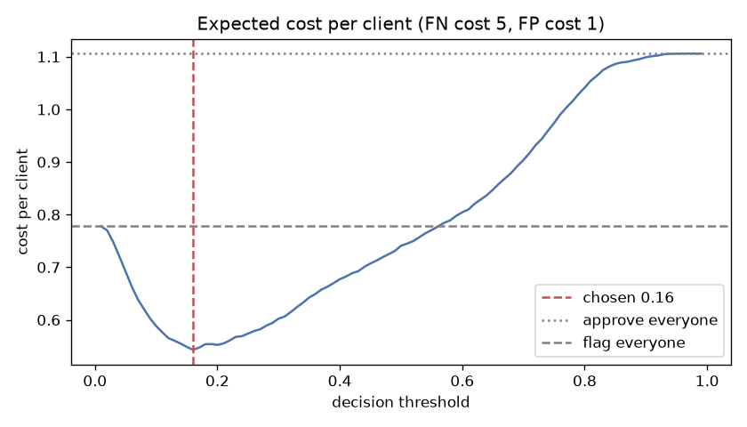
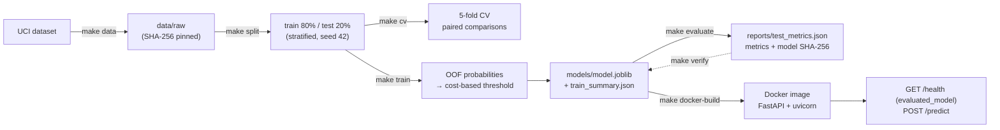

# Credit Card Default Risk

[](https://github.com/vladzpop11/credit-default-risk/actions/workflows/ci.yml)

Predict whether a credit card client will miss next month's payment, choose the decision threshold from the cost of each kind of error, and serve the model as a containerised API.

## Result in brief

| On 6,000 held-out test clients | Value (95% bootstrap CI) |
| --- | --- |
| PR-AUC (no-skill baseline 0.221) | **0.554** (0.527–0.585) |
| Defaulters caught at threshold 0.16 | **74.6%** (72.5–76.9%) |
| Error-cost cut vs flagging everyone, the cheaper trivial policy | **27%** (23–31%) |
| Error-cost cut vs approving everyone | 49% (46–52%) |

- **A simple rule gets most of the way.** "Flag anyone who was late in the last 6 months" has no fitted parameters and already cuts the cost by 26% on the training data. The model's real added value is a further **5%** cost reduction, and 11 percentage points more defaulters caught. On this data, recent repayment behaviour carries most of the signal.
- **Sex, marital status and age are not used.** Dropping them cost nothing measurable in cross-validation.
- **[Model card](MODEL_CARD.md):** intended use, performance, fairness audit and behavioural tests on one page.



## How to run

Requires Python 3.12 via [uv](https://docs.astral.sh/uv/), `make` and Docker. The image is built for `linux/amd64`, so on Apple Silicon it runs under emulation and is slower.

```bash
make demo        # download (SHA-256 checked), split, train if no model exists, build and start the API
```

- **Changing the port or container name:** `make demo PORT=8080 NAME=my-api`, then stop it with `make docker-stop NAME=my-api`.
- **Once it's running:** open http://localhost:8000/docs, or run:

```bash
curl -s localhost:8000/health
curl -s -X POST localhost:8000/predict -H 'Content-Type: application/json' -d @tests/example_client.json
make docker-stop
```

- **Input names:** they are the UCI column names, except that the UCI `PAY_0` is called `PAY_1` here, to line up with `BILL_AMT1` and `PAY_AMT1` (all September 2005).
- **Validation:** the API rejects unknown fields (including sex, marital status and age), wrong JSON types, out-of-range values, duplicate keys, non-JSON content and bodies over 16 KB.
- **Errors:** the API's own errors (404, 405, 413, 415, 422, 500) all have the shape `{"detail": [{"type", "loc", "msg"}]}`, and never echo the submitted values. Two kinds come from the uvicorn server itself, in plain text: malformed HTTP, and a `503` when more than 64 requests are in flight at once (load shedding).

`make help` lists all targets: `check` (Ruff and pytest), `eda`, `cv`, `analysis`, `uncertainty`, `serve` (the API without Docker), `docker-smoke` and more.

## Problem

- **The decision:** a card issuer reviews its clients every month. For each client the model estimates the probability of default on the next payment, and clients above a threshold are flagged for a cheap intervention: a review, a reminder or a lower limit.
- **The cost assumption:** a missed defaulter is assumed to cost **5** times as much as a false alarm. Correct decisions cost nothing.
- **How success is measured:** expected error cost per client, compared with simple policies.
- **The ranking metric:** PR-AUC (average precision). Only 22% of clients default, so accuracy would mislead.

## Data

- **Source:** [Default of Credit Card Clients](https://archive.ics.uci.edu/dataset/350/default+of+credit+card+clients) (Yeh & Lien, 2009), UCI Machine Learning Repository, licensed [CC BY 4.0](https://creativecommons.org/licenses/by/4.0/).
- **Contents:** 30,000 clients of a Taiwanese bank, observed April to September 2005, with the target in October 2005. The features are the credit limit, demographics, and 6 months of repayment status, bill amounts and payments.
- **Integrity check:** `make data` checks the downloaded file against a SHA-256 pinned in `configs/config.yaml`.

## Approach

1. **Split first.** The data is split 80/20, stratified, into train and test sets, with 22.12% defaults in both. No modelling decision uses the test set; see [Test-set use](#test-set-use).
2. **Exploration on train only** ([reports/eda.md](reports/eda.md)). Recent repayment status dominates. The categorical codes include undocumented values, the repayment codes are not used consistently across months, the bill amounts are collinear and skewed, and each payment settles the *previous* month's bill.
3. **A pipeline that cannot leak.**
   - Cleaning and the engineered features (`months_late`, `max_months_late`, utilisation, payment ratio) are computed row by row.
   - Imputation, scaling and one-hot encoding are fitted inside a scikit-learn `Pipeline`, on each training fold only.
   - The same `prepare()` function runs in training and in the API.
   - Tests check that the model inputs cannot depend on the target, that every out-of-fold score comes from a pipeline refitted without that fold, and that a training path scoring rows its model has seen would be caught.
4. **Model selection** ([reports/cv_results.md](reports/cv_results.md)): stratified 5-fold cross-validation, with every model on the same folds and compared through paired fold differences.
   - **XGBoost was chosen before the test set was opened.** With 5 folds it cannot be distinguished from random forest (+0.004 PR-AUC, p = 0.23), or from a logistic regression that one-hot encodes the repayment codes, compared like for like without the sensitive attributes (+0.011, p = 0.25).
   - The one-hot logistic regression was added after a review. The original logistic regression, which treated the codes as numbers, loses clearly (+0.045, p = 0.003).
   - p-values come from paired t-tests with the Nadeau–Bengio correction for overlapping cross-validation training sets.
   - **The tie was broken by speed:** one cross-validation run takes about 5–9 s for XGBoost against 34–43 s for the random forest on this machine (the times vary with load; see `cv_results.md`).
   - **All models use fixed, untuned settings.**
5. **Sensitive attributes removed.** Dropping sex, marital status and age changed cross-validated PR-AUC by −0.0002, paired fold standard deviation 0.0039, corrected p = 0.94. They are not model inputs, and the API does not accept them.
6. **Cost-based threshold** ([reports/error_analysis.md](reports/error_analysis.md)). 0.16 minimises the expected cost on out-of-fold predictions. That is consistent with the Bayes-optimal 1/(1+5) ≈ 0.167, as expected given good calibration near that value. The per-fold optima range from 0.16 to 0.20.

## Results

Cross-validation on the training split (5 folds, mean ± std):

| Model | PR-AUC | ROC-AUC |
| --- | --- | --- |
| Baseline (prior) | 0.221 ± 0.000 | 0.500 ± 0.000 |
| Logistic regression (repayment codes as numbers) | 0.515 ± 0.013 | 0.764 ± 0.008 |
| Logistic regression (repayment codes one-hot) | 0.551 ± 0.020 | 0.781 ± 0.009 |
| Logistic regression (one-hot, without sex, marital status, age) | 0.549 ± 0.020 | 0.780 ± 0.009 |
| Random forest | 0.555 ± 0.012 | 0.782 ± 0.008 |
| XGBoost | 0.560 ± 0.013 | 0.784 ± 0.006 |
| **XGBoost without sex, marital status, age (chosen)** | **0.560 ± 0.013** | **0.783 ± 0.006** |

Final model, threshold 0.16 ([reports/test_metrics.json](reports/test_metrics.json), intervals in [reports/test_uncertainty.json](reports/test_uncertainty.json)):

| | Out-of-fold (train) | Test |
| --- | --- | --- |
| PR-AUC | 0.559 | 0.554 (0.527–0.585) |
| ROC-AUC | 0.783 | 0.776 |
| Recall | 76.7% | 74.6% (72.5–76.9%) |
| Precision | 37.3% | 36.5% |
| Clients flagged | 45.5% | 45.2% |
| Cost per client (one false alarm = 1) | 0.543 | 0.568 |
| … if everyone is flagged | 0.779 | 0.779 |
| … if everyone is approved | 1.106 | 1.106 |
| … with the rule "flag anyone ever late" | 0.574 | not evaluated |

- **The test PR-AUC agrees with the out-of-fold PR-AUC.** The gap is −0.004, with a 95% CI of −0.032 to +0.026. That interval treats the out-of-fold value as fixed, so it slightly understates the uncertainty.
- **No hyperparameters were tuned,** so this is a check on the estimate, not on overfitting to the folds.
- **The test clients come from the same months as the training clients,** so the result says nothing about later months.
- **Serving:** CPU inference in Docker on a 2-core 2018 MacBook Air takes 34 ms on average and 41 ms at p95 per request, end to end over HTTP (50 requests after a warm-up). Measured with `make latency`; recorded in [reports/latency.json](reports/latency.json), which is only updated when the evaluated model is being served (other measurements go to `models/latency.json`).

### Test-set use

The test set has been evaluated twice, and both results are kept.

1. **Version 1** ([reports/history/v1](reports/history/v1)): test PR-AUC 0.556, cost per client 0.564.
2. **A bug, found by a code review and not by looking at test scores.** The `payment_ratio_1` feature divided the September payment by the September bill, but a payment settles the previous month's statement. The fix was committed to be adopted whatever its effect on any score.
3. **Version 2, the current model.** After the fix, cross-validation was re-run (the model ranking did not change), and the model was retrained and evaluated again. The fix made no material difference: test PR-AUC 0.554 against 0.556, well inside the test set's own uncertainty.
4. **Uncertainty intervals, added later.** `make uncertainty` re-scores the test set with the evaluated model and stops unless the result matches the recorded metrics exactly. It then bootstraps the test clients. Nothing is retrained or re-chosen.

<details>
<summary><b>Reproducibility and model files</b></summary>

- **Same platform:** retraining gives bit-identical predictions, verified on macOS and independent of xgboost's thread count. The model file's SHA-256 still changes on every retrain, because the bundle stores its training time.
- **Across platforms:** the macOS and Linux builds of xgboost 3.4.1 differ in floating-point detail, so a retrain on Linux gives a slightly different model:

  | Trained on | OOF PR-AUC | Threshold |
  | --- | --- | --- |
  | macOS x86_64 (the evaluated model) | 0.5589 | 0.16 |
  | Linux x86_64 (as in CI; printed by its `make reproduce-check` step) | 0.5573 | 0.16 |

- **The released artifact is the evaluated model file, not a retrain.** Its SHA-256 is recorded in `reports/test_metrics.json`, and `GET /health` reports `"evaluated_model": true` only for that file. The file is not in git, so on a fresh clone `make demo` trains a new model, and `/health` says `false`.
- **`make verify`** checks that `models/model.joblib` is the evaluated file. **`make reproduce-check`** checks that a local retrain is within 0.005 PR-AUC and 0.02 threshold of it; when the local model *is* the evaluated file, it passes and says so. Both fail when the check fails, and `make evaluate` refuses to run twice. The Python modules exit with status 1; through `make` you see `make: *** Error 1` and the shell gets status 2. Both are intended.
- **Where training output goes:** retraining writes only to `models/` (the model and `train_summary.json`). The tracked record of the evaluated model in `reports/` is never overwritten.
- **Model files are pickles.** Loading one runs code inside it, so only load files you trust. Set `MODEL_SHA256` to make the API refuse any other file before unpickling it.
- **CI** checks dependencies for known vulnerabilities and runs the tests. It then retrains from the public source, runs `make reproduce-check` and the behavioural tests (`make test-model`), builds the image and smoke-tests it. The image is not published.

</details>

## Architecture



| File | Role |
| --- | --- |
| `src/credit_default_risk/features.py` | Cleaning, engineered features and the preprocessing pipeline, shared by training and serving |
| `src/credit_default_risk/train.py` | Out-of-fold threshold choice and final fit; refuses to replace the evaluated model |
| `src/credit_default_risk/evaluate.py` | Test evaluation, with a guard against reuse |
| `src/credit_default_risk/artifacts.py` | Artifact locations, SHA-256 records, library versions |
| `src/credit_default_risk/api.py` | FastAPI service with a strict schema and request guards |
| `src/credit_default_risk/cv.py`, `analysis.py`, `uncertainty.py` | Model comparison; threshold, baseline, calibration and fairness analysis; test intervals |
| `.github/workflows/ci.yml` | Audit, lint, tests, retrain with a tolerance check, image build and smoke test |

## Limitations

- **Clean-history defaulters are a blind spot.** 91% of the missed defaulters had no late payment in the previous 6 months. The data has no income, other debts or bureau score, so these clients look like good ones.
- **The model adds a modest amount over a simple rule.** It improves on "flag anyone ever late" by about 5% of the cost. A lender might reasonably prefer the rule for its transparency.
- **The test set is from the same period.** The split is random within one observation window, so the test score covers unseen clients from that period, not future months.
- **The 5:1 cost ratio is an assumption, and the results depend on it.**
  - At 5:1, 45% of clients are flagged, which only makes sense for a cheap action.
  - Flagging a defaulter is assumed to prevent the whole loss at no cost.
  - The cut against the best trivial policy ranges from 10% (10:1) to 40% (3:1).
  - The model's lead over the "ever late" rule ranges from 3% (4:1) to 27% (10:1); see the sensitivity table in [error_analysis.md](reports/error_analysis.md).
- **Indirect group differences remain.**
  - Good clients aged 21–25 are wrongly flagged 50% of the time, against 34% for ages 26–40. That is mostly because the bank gave them lower credit limits; at the 26–40 limit mix their rate would be 30%.
  - The model slightly under-predicts risk for ages 41–60 (22.5% predicted vs 23.8% observed). That gap is significant after correcting for 6 comparisons; men show the same direction, just short of significance.
- **The model behaves oddly where data is thin.**
  - Predicted risk peaks at three months late and *drops* for longer delays. Only one training client was four or more months late in all six months.
  - "Other" education (386 training clients, 7.3% default rate) sharply lowers predicted risk.
  - Credit limits below NT$10k, the training minimum, are treated like NT$10k.
  - Monotonic constraints would be a sensible next step. A behavioural test records the long-delay drop as an expected failure until then; see the [model card](MODEL_CARD.md#behavioural-tests).
- **The probabilities are mildly overconfident.** The lowest deciles are under-predicted and the highest over-predicted, each by up to 1.6 percentage points (Brier score 0.134). Calibration near the threshold is good.
- **The API is not production hardening on its own.** TLS, rate limits and timeouts for slow clients belong in a reverse proxy in front of it.
- **The data is old and from one market** (Taiwan, 2005, a period of rising card debt). The model would need revalidation on current data and monitoring for drift.

## Next steps

- Publish the evaluated model file as a versioned artifact (a GitHub release asset, or a model registry such as MLflow).
- Add monotonic constraints on repayment status, and compare against the one-hot logistic regression as a more transparent option.
- Replace the assumed cost matrix with real loss and intervention costs, and consider a three-way decision (approve / review / act).
- Evaluate on a later time period, and monitor drift on incoming data.
