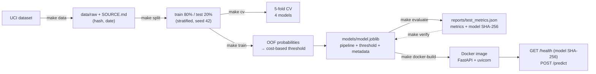

# Credit Card Default Risk

Predict whether a credit card client will miss next month's payment, choose the decision threshold from the cost of each kind of error, and serve the model as a containerised API.

**Result:** on a held-out test set of 6,000 clients, the model cuts the expected cost of errors by **49%** compared with approving everyone. It catches **75% of defaulters** (PR-AUC 0.554 against a 0.221 no-skill baseline), without using sex, marital status or age.

## Problem

A card issuer reviews its clients every month. For each client the model estimates the probability of defaulting on the next payment, and clients above a threshold are flagged for action (manual review, a reminder or a lower limit).

Missing a defaulter is assumed to cost **5 times** as much as flagging a client who would have paid. Success is measured as the expected cost per client against the policy of flagging no one. PR-AUC is the ranking metric, because only 22% of clients default and accuracy would be misleading.

## Data

[Default of Credit Card Clients](https://archive.ics.uci.edu/dataset/350/default+of+credit+card+clients) (Yeh & Lien, 2009), UCI Machine Learning Repository, licensed [CC BY 4.0](https://creativecommons.org/licenses/by/4.0/). The data covers 30,000 clients of a Taiwanese bank, observed April to September 2005, with the target being October 2005. The features are the credit limit, demographics, and 6 months of repayment status, bill amounts and payments.

`make data` downloads the data and records the source, date and SHA-256 hash in `data/raw/SOURCE.md`.

## Approach

1. **Split first.** The data is split 80/20 into train and test, stratified at 22.12% defaults in both. The test set is not used for any modelling decision; see [Test-set use](#test-set-use) for the two times it was evaluated.
2. **Exploration on train only** ([reports/eda.md](reports/eda.md)). Recent repayment status dominates: clients late last month default at 50.4%, against 13.7% for everyone else. The categorical codes contain undocumented values, the bill amounts are highly collinear and skewed, and each payment settles the *previous* month's bill.
3. **No-leakage pipeline.** Cleaning and engineered features (`months_late`, `max_months_late`, utilisation, payment ratio) are computed row by row. Imputation, scaling and one-hot encoding are fitted inside a scikit-learn `Pipeline` on each training fold only. The same `prepare()` function runs in training and in the API. Tests check this on the real training path, with a shuffled-label canary and a per-fold refit comparison.
4. **Model selection** with stratified 5-fold cross-validation ([reports/cv_results.md](reports/cv_results.md)): a prior baseline, logistic regression, random forest and XGBoost. XGBoost was chosen before the test set was opened.
5. **Sensitive attributes removed.** Dropping sex, marital status and age cost 0.0002 PR-AUC in cross-validation, against a fold-to-fold standard deviation of 0.012. They are not model inputs, and the API does not accept them.
6. **Cost-based threshold** ([reports/error_analysis.md](reports/error_analysis.md)). The threshold 0.16 minimises expected cost on out-of-fold predictions. It matches the decision-theory optimum 1/(1+5) ≈ 0.167, because the model is well calibrated overall (mean prediction 0.220 vs 0.221 observed).

## Results

Cross-validation on the training split (5 folds, mean ± std):

| Model | PR-AUC | ROC-AUC |
| --- | --- | --- |
| Baseline (prior) | 0.221 ± 0.000 | 0.500 ± 0.000 |
| Logistic regression | 0.515 ± 0.012 | 0.764 ± 0.007 |
| Random forest | 0.555 ± 0.011 | 0.782 ± 0.007 |
| XGBoost | 0.560 ± 0.012 | 0.784 ± 0.005 |
| **XGBoost without sex, marital status, age (chosen)** | **0.560 ± 0.012** | **0.783 ± 0.005** |

Final model, threshold 0.16 ([reports/test_metrics.json](reports/test_metrics.json)):

| | Out-of-fold (train) | Test |
| --- | --- | --- |
| PR-AUC | 0.559 | 0.554 |
| ROC-AUC | 0.783 | 0.776 |
| Recall | 76.7% | 74.6% |
| Precision | 37.3% | 36.5% |
| Clients flagged | 45.5% | 45.2% |
| Cost per client (no model: 1.106) | 0.543 | 0.568 |

The test PR-AUC is within 0.005 of cross-validation, so there is no sign of overfitting to the validation folds.

**Serving:** CPU inference in Docker on a 2-core 2018 MacBook Air takes 32 ms on average and 51 ms at p95 per request, end to end over HTTP (50 requests).

### Test-set use

The test set has been evaluated twice, and both results are kept.

1. **Version 1** ([reports/history/v1](reports/history/v1)): test PR-AUC 0.556, cost per client 0.564.
2. **A bug found afterwards, by a code review rather than by looking at test scores.** The `payment_ratio_1` feature divided the September payment by the September bill, but a payment settles the previous month's statement. The fix was committed to be adopted whatever its effect on any score.
3. **Version 2, the current model.** After the fix, cross-validation was re-run (the model ranking was unchanged), and the model was retrained and evaluated a second time. The fix made no material difference: test PR-AUC 0.554 vs 0.556.

## Reproducibility

- **Same platform:** retraining gives bit-identical predictions (verified on macOS; independent of xgboost's thread count).
- **Across platforms:** the macOS and Linux builds of the same xgboost version (3.4.1) differ in floating-point detail, so a retrain on Linux gives a slightly different model:

  | Trained on | OOF PR-AUC | Threshold |
  | --- | --- | --- |
  | macOS x86_64 (the evaluated model) | 0.5589 | 0.16 |
  | Linux x86_64 (as in CI) | 0.5573 | 0.16 |

- **The released artifact is therefore the evaluated model file, not a retrain.** Its SHA-256 is recorded in `reports/test_metrics.json` and returned by `GET /health`. `make verify` checks that `models/model.joblib` is that file.
- **CI** retrains from the public source and runs `make reproduce-check`. It fails if the retrained PR-AUC drifts more than 0.005 from the evaluated model, or the threshold more than 0.02. The image CI builds is a build test and is not published.

## Architecture



| File | Role |
| --- | --- |
| `src/credit_default_risk/features.py` | Cleaning, engineered features and preprocessing pipeline, shared by training and serving |
| `src/credit_default_risk/train.py` | Out-of-fold threshold choice, final fit, model bundle with hash and library versions; refuses to replace the evaluated model |
| `src/credit_default_risk/evaluate.py` | Test evaluation, with a guard against reuse |
| `src/credit_default_risk/verify.py` | Checks that the model file is the evaluated one (`verify`), or that a retrain is within tolerance (`reproduce-check`) |
| `src/credit_default_risk/api.py` | FastAPI service with a strict Pydantic schema |
| `.github/workflows/ci.yml` | Lint, tests, retraining from the public source with a tolerance check, image build test |

## How to run

Requires [uv](https://docs.astral.sh/uv/) and Docker.

```bash
make demo        # download, split, train (only if no model exists), build the image, start the API
```

Then open http://localhost:8000/docs, or:

```bash
curl -s localhost:8000/health
curl -s -X POST localhost:8000/predict -H 'Content-Type: application/json' -d '{
  "LIMIT_BAL": 50000, "EDUCATION": 2,
  "PAY_1": 2, "PAY_2": 2, "PAY_3": 0, "PAY_4": 0, "PAY_5": 0, "PAY_6": 0,
  "BILL_AMT1": 48000, "BILL_AMT2": 47000, "BILL_AMT3": 46000,
  "BILL_AMT4": 30000, "BILL_AMT5": 28000, "BILL_AMT6": 25000,
  "PAY_AMT1": 0, "PAY_AMT2": 1500, "PAY_AMT3": 1500,
  "PAY_AMT4": 1200, "PAY_AMT5": 1000, "PAY_AMT6": 1000}'
make docker-stop
```

The model file is not in git. On a fresh clone `make demo` trains a new model, which `make verify` will correctly report as not the evaluated one, and whose metrics `make reproduce-check` compares.

Other targets: `make check` (Ruff + pytest), `make eda`, `make cv`, `make analysis`, `make serve` (API without Docker).

## Limitations

- **Clean-history defaulters are a blind spot.** 91% of the missed defaulters were never late in the previous 6 months. The data has no income, other debts or bureau score, so these clients look like good ones.
- **The 5:1 cost ratio is an assumption.** At this ratio 45% of clients are flagged, which only makes sense if the action is cheap (a reminder or a review, not a refusal). The cost curve is flat between about 0.12 and 0.25, so the threshold can be raised with little loss.
- **Indirect group differences remain.** Without using age, good clients aged 21–25 are still flagged 50% of the time, against 34% for ages 26–40, mostly through lower credit limits. The model also slightly under-predicts risk for ages 41–60 (22.5% predicted vs 23.8% observed). This needs a review before any real use.
- **The evaluated model file is not distributed with the repo.** A clone can reproduce the results within tolerance, but not the exact file.
- **The data is old and from one market** (Taiwan, 2005, a period of rising card debt). The model would need revalidation on current data, and monitoring for drift.

## Next steps

- Publish the evaluated model as a versioned artifact (a GitHub release asset, or the MLflow model registry in the MLOps capstone project).
- Calibrate the cost matrix with real loss and review costs, and consider a three-way decision (approve / review / act).
- Add a fairness constraint or per-group threshold analysis, and document it in a model card.
- Monitor drift on incoming data (covered in the MLOps capstone project).
